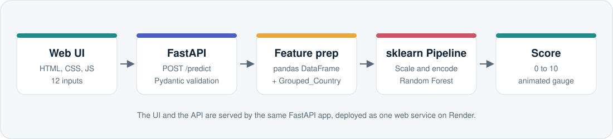
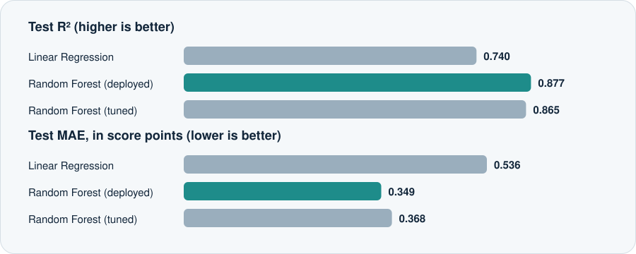
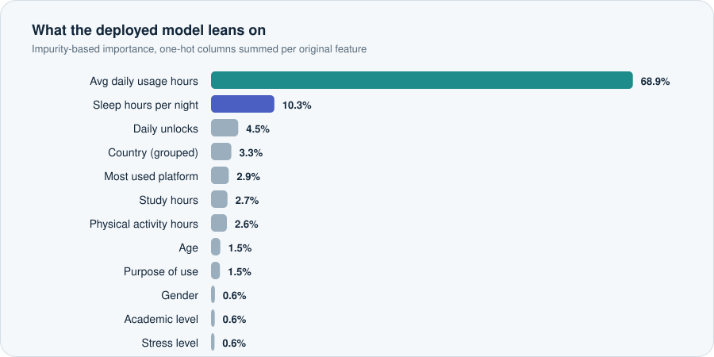

<p align="center">
  
</p>

<p align="center">
  <a href="https://mental-health-score-6m0h.onrender.com/"></a>
  <a href="https://mental-health-score-6m0h.onrender.com/docs"></a>
</p>

<p align="center">
  
  
  
  
  
</p>

<p align="center">
  <b>Tell it how you use your phone, sleep and study. It estimates a mental health score out of 10.</b><br>
  A machine learning model, a FastAPI backend and an animated web UI, deployed end to end.
</p>

---

## Contents

[Overview](#overview) · [Live demo](#live-demo) · [How it works](#how-it-works) · [Dataset](#dataset) · [Model and results](#model-and-results) · [API](#api-reference) · [Run locally](#run-locally) · [Deploy on Render](#deploy-on-render) · [Project structure](#project-structure) · [Limitations](#limitations-and-responsible-use) · [Roadmap](#roadmap)

## Overview

Does more screen time go with lower wellbeing? This project explores that question with data. It trains a regression model on a survey of 5,000 students and serves it through a REST API with a custom front end, so anyone can try it in a browser.

**Highlights**

- **12 inputs, 1 score.** Demographics, social media habits, sleep, study, activity and stress go in; a 0 to 10 score comes out.
- **Full ML workflow.** EDA, cleaning, feature engineering, three models compared, and a saved scikit-learn `Pipeline` (see [`MHSP.ipynb`](MHSP.ipynb)).
- **Production-style API.** Strict request validation with Pydantic, typed responses, auto-generated docs at `/docs`.
- **A UI with some care put into it.** A breathing orb and ring gauge that animate to your result, sliders that fill as you drag, and a live bar showing how your 24 hours are split.
- **One deployable service.** FastAPI serves both the API and the static UI, so there is nothing else to host.

## Live demo

**[mental-health-score-6m0h.onrender.com](https://mental-health-score-6m0h.onrender.com/)**

> The app runs on Render's free tier, which sleeps after a period of inactivity. If the first request takes 30 to 50 seconds, the server is waking up. Later requests are fast.

<!-- Add a screenshot of the live app here:
<p align="center"></p>
-->

## How it works

<p align="center">
  
</p>

1. The browser collects the 12 answers and sends them as JSON to `POST /predict`.
2. FastAPI validates every field (types, allowed categories, numeric ranges) with Pydantic.
3. The values are placed in a one-row pandas DataFrame, and the country is collapsed into the same top-10 groups used in training.
4. The saved scikit-learn pipeline scales numbers, encodes categories and runs the random forest.
5. The score is rounded to two decimals and returned; the UI animates the gauge to it and shows a short interpretation.

## Dataset

[`Student Social Media And Mental Health Impact.csv`](<Student Social Media And Mental Health Impact.csv>) holds **5,000 rows and 13 columns**, with no missing values.

| Feature | Type | Range or values in the data |
|---|---|---|
| Age | numeric | 18 to 24 |
| Gender | categorical | Male, Female |
| Country | categorical | Grouped into the top 10 values, everything else becomes `Other` |
| Academic level | categorical | High School, Undergraduate, Graduate |
| Most used platform | categorical | 12 platforms (Instagram, TikTok, Facebook, LinkedIn, YouTube, Twitter, Snapchat, WhatsApp, LINE, VKontakte, KakaoTalk, WeChat) |
| Purpose of use | categorical | Networking, Education, Entertainment, News |
| Avg daily usage (h) | numeric | 1.0 to 8.8 |
| Daily phone unlocks | numeric | 62 to 273 |
| Study hours | numeric | 0.3 to 8.3 |
| Physical activity (h) | numeric | up to 4.1 |
| Sleep per night (h) | numeric | 3.6 to 9.9 |
| Stress level | ordinal | Low, Medium, High, Very High |
| **Mental health score** | **target** | **3.6 to 9.4 (mean 6.23)** |

**Cleaning:** 2 duplicate rows were dropped, and negative physical activity values (an impossible `-0.4`) were clipped to 0.

## Model and results

**Preprocessing** (one `ColumnTransformer`, so the exact same steps run at training and prediction time):

| Columns | Transform |
|---|---|
| Study hours (right-skewed) | `log1p`, then `StandardScaler` |
| Age, usage, sleep, activity, unlocks | `StandardScaler` |
| Stress level | `OrdinalEncoder` (Low < Medium < High < Very High) |
| Gender, academic level, platform, purpose, grouped country | `OneHotEncoder(handle_unknown="ignore")` |

The data was split 70/30 with `random_state=42`. Three models were compared:

<p align="center">
  
</p>

| Model | Test R² | Train R² | MAE | RMSE |
|---|---|---|---|---|
| Linear Regression | 0.740 | 0.724 | 0.536 | 0.676 |
| **Random Forest (default), deployed** | **0.877** | 0.981 | **0.349** | **0.464** |
| Random Forest (tuned, `RandomizedSearchCV`, 15 iterations, 5-fold) | 0.865 | 0.956 | 0.368 | 0.487 |

On average the deployed model is off by about **0.35 points** on a 10-point scale.

The gap between train R² (0.98) and test R² (0.88) shows the default forest fits the training data very closely. Tuning narrowed that gap but did not improve test accuracy, and the default model was kept.

### What drives the prediction

<p align="center">
  
</p>

Average daily usage is by far the strongest signal in this dataset, followed by sleep. Treat this as a description of what the model learned from this particular data, not as proof that screen time causes lower wellbeing. See [Limitations](#limitations-and-responsible-use).

## API reference

Interactive docs are available at [`/docs`](https://mental-health-score-6m0h.onrender.com/docs) (Swagger UI).

| Method | Path | Description |
|---|---|---|
| `GET` | `/` | Serves the web UI |
| `GET` | `/health` | Returns `{"status": "ok"}` |
| `POST` | `/predict` | Returns the predicted score |

**Request**

```bash
curl -X POST https://mental-health-score-6m0h.onrender.com/predict \
  -H "Content-Type: application/json" \
  -d '{
    "age": 21,
    "gender": "Female",
    "country": "India",
    "academic_level": "Undergraduate",
    "most_used_platform": "Instagram",
    "purpose_of_use": "Entertainment",
    "avg_daily_usage_hours": 5.5,
    "daily_unlocks": 170,
    "study_hours": 3,
    "physical_activity_hours": 1.5,
    "sleep_hours_per_night": 6.5,
    "stress_level": "Medium"
  }'
```

**Response**

```json
{ "predicted_mental_health_score": 6.06 }
```

**Validation rules** (invalid input returns `422`)

| Field | Rule |
|---|---|
| `age` | integer, 0 to 100 |
| `gender` | `Male` or `Female` |
| `country` | any string (unseen countries are grouped as `Other`) |
| `academic_level` | `High School`, `Undergraduate`, `Graduate` |
| `most_used_platform` | one of the 12 platforms listed above |
| `purpose_of_use` | `Networking`, `Education`, `Entertainment`, `News` |
| `avg_daily_usage_hours`, `study_hours`, `sleep_hours_per_night` | float, 0 to 24 |
| `daily_unlocks` | integer, 0 or more |
| `physical_activity_hours` | float, 0 to 2 |
| `stress_level` | `Low`, `Medium`, `High`, `Very High` |

## Run locally

```bash
git clone https://github.com/devbytush/Mental-Health-Score.git
cd Mental-Health-Score

python -m venv venv
source venv/bin/activate        # Windows: venv\Scripts\activate

pip install -r requirements.txt
uvicorn main:app --reload
```

Open <http://localhost:8000> for the app or <http://localhost:8000/docs> for the API docs.

> The `.pkl` file is a pickled scikit-learn pipeline, so it only loads reliably with the same library version it was saved with. `requirements.txt` pins `scikit-learn==1.6.1` for that reason. Don't upgrade it without re-exporting the model from the notebook.

## Deploy on Render

1. Create a **Web Service** on [Render](https://render.com) and connect this repository.
2. Set the following:

   | Setting | Value |
   |---|---|
   | Build command | `pip install -r requirements.txt` |
   | Start command | `uvicorn main:app --host 0.0.0.0 --port $PORT` |
   | Environment variable | `PYTHON_VERSION` = `3.11.9` |

3. Deploy. Render sets `$PORT` automatically.

Render does not read `runtime.txt`; use the `PYTHON_VERSION` variable (or a `.python-version` file) so that pinned packages install from prebuilt wheels instead of compiling from source.

## Project structure

```
Mental-Health-Score/
├── main.py                      # FastAPI app: validation, prediction, static UI mount
├── Mental_Health_Model.pkl      # Saved scikit-learn pipeline (preprocessing + random forest)
├── MHSP.ipynb                   # EDA, cleaning, training and evaluation
├── Student Social Media And Mental Health Impact.csv
├── requirements.txt
├── runtime.txt
├── assets/                      # README images
└── static/
    ├── index.html               # UI shell
    ├── style.css                # Layout, theme and animations
    └── app.js                   # Form, live day bar, API call, animated gauge
```

## Tech stack

| Layer | Tools |
|---|---|
| Machine learning | scikit-learn, pandas, NumPy, joblib |
| Analysis | Jupyter, matplotlib, seaborn |
| Backend | FastAPI, Pydantic, Uvicorn |
| Frontend | HTML, CSS, vanilla JavaScript (no framework, no build step) |
| Hosting | Render |

## Limitations and responsible use

This is a learning project and **not a diagnostic or clinical tool.** A score from this app says nothing definitive about anyone's mental health. If you are struggling, please talk to someone you trust or a qualified professional.

- **Correlation, not causation.** The model finds patterns in one survey. It cannot say that reducing screen time would change a person's wellbeing.
- **Narrow data.** Training ages are 18 to 24 and daily usage is 1 to 9 hours. Inputs far outside those ranges are extrapolation, and a random forest cannot predict outside the score range it saw (about 3.6 to 9.4).
- **Self-reported and aggregated.** Survey answers are subjective, and the dataset reflects a single sample of students.
- **Overfitting signal.** The large train/test R² gap suggests more regularisation or more data would help.

## Roadmap

- [ ] Per-prediction explanations (for example SHAP) so users see what moved their score
- [ ] Prediction intervals from the spread of the forest's trees
- [ ] Compare gradient boosting models and cross-validate the final choice
- [ ] Tests for the API and a CI workflow
- [ ] Dockerfile for one-command deployment

## Author

Built by **[@devbytush](https://github.com/devbytush)**. If this project was useful or interesting, a star is always appreciated.
